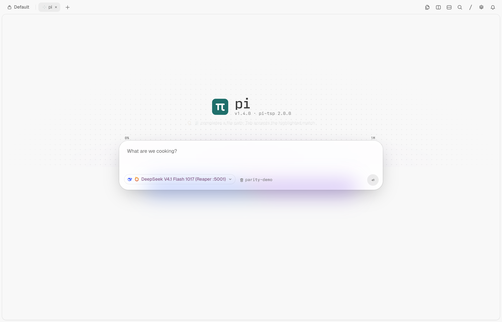
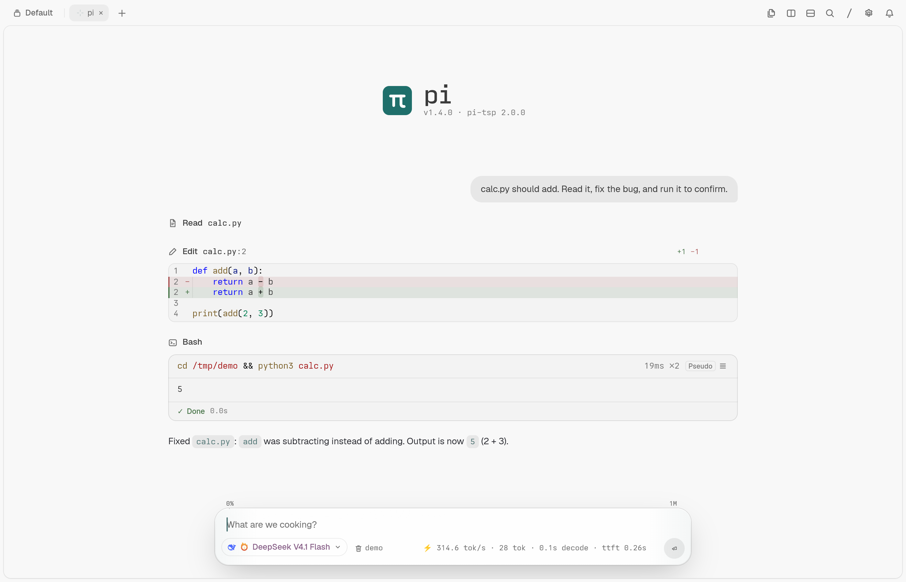
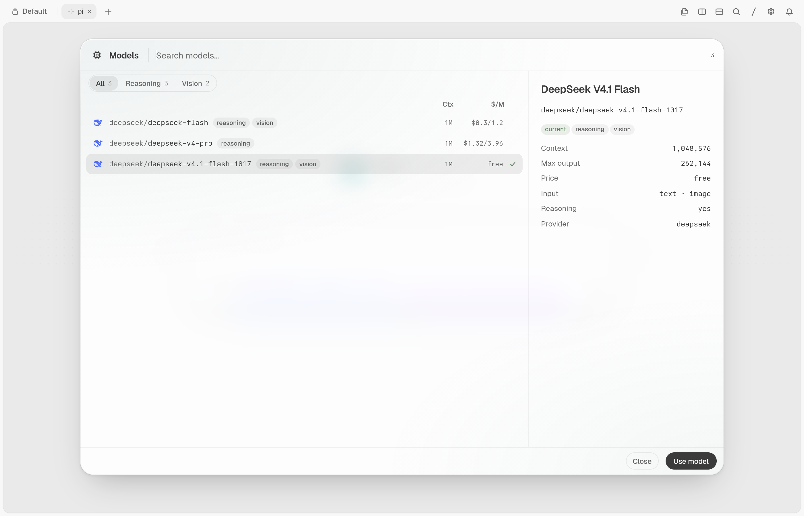
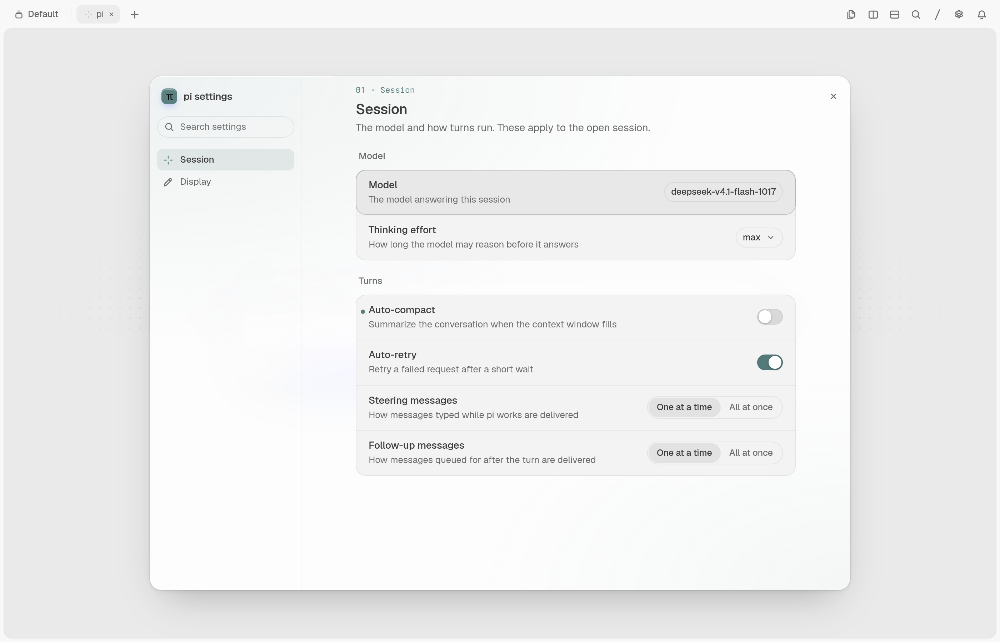
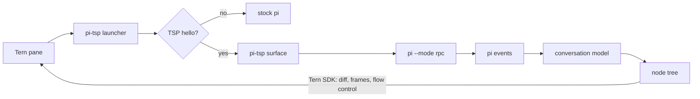

<p align="center">
  
</p>

<h1 align="center">pi-tsp</h1>

<h3 align="center">The pi coding agent, rendered native in Tern.</h3>

<p align="center">
  A real surface for pi: semantic markdown, tool cards, diffs, subagents,
  approvals, model and effort pickers, session management, and a composer that
  belongs in Tern.<br>
  No ANSI mirror. No patched pi. Stock pi outside Tern.
</p>

<p align="center">
  
  
  
  
  <a href="https://github.com/MadeBy561/pi-tsp/actions/workflows/ci.yml"></a>
  <a href="https://github.com/MadeBy561/pi-tsp/releases"></a>
</p>

<p align="center">
  
</p>

---

## Why this exists

`pi` is a strong terminal coding agent. Tern can render native surfaces, but a
terminal agent that only paints ANSI gives Tern nothing to work with: every
message is a wall of text in a grid.

`pi-tsp` keeps pi as the engine and gives Tern the conversation as data. It
speaks the Tern Surface Protocol, runs `pi --mode rpc` as a child, and renders
the transcript itself. Markdown is markdown. A tool call is a card with its
arguments and result. A diff is a diff. A subagent is a row you can open. The
composer is a Tern composer, not a cursor in a terminal.

The boundary is deliberate: pi owns the agent loop, tools and sessions; pi-tsp
owns the surface. Nothing in pi is patched, and outside Tern `pi-tsp` execs
stock `pi` with the original arguments.

## What it does

<p align="center">
  
</p>

Everything is drawn with Tern's own components, the way
[omp](https://github.com/can1357/oh-my-pi)'s surface is, so it looks and
behaves like the rest of Tern.

| Area | What you get |
|---|---|
| Transcript | Markdown answers that stream, collapsible thinking with its duration, a per-turn footer (time, tokens, cost, copy), a frame for failed requests with Retry, compaction and branch summaries, extension messages, bar charts after tables of numbers, skill prompts as chips |
| Tools | `bash` in Tern's command pane with live output, per-line results and a step-by-step replay, `edit` as a diff that streams with the model's arguments, `write`, `read` (consecutive reads grouped), `grep` / `find` / `ls` with counts, `todo` as a checklist, any other tool with its arguments and JSON or text result |
| Subagents | `pi-subagents` and `@tintinweb/pi-subagents` runs as agent rows with model, tool count, tokens and time; a transcript sheet for each |
| Composer | Selection, undo and redo, word and line motions, optional Vim keys, large pastes as chips, image paste and `/attach`, `$EDITOR` with Ctrl+G, prompt history with search |
| Completion | A popup at the caret for `/` commands (pi-tsp's and pi's) and `@` files with fuzzy matching |
| While pi works | A working row with what it is doing, the todo list as a HUD, steering by typing, a queue for follow-ups (Alt+Enter) you can pull back (Alt+Up), Esc to stop |
| Pickers | Models (search, providers, capabilities, price, details, maker logos), thinking effort, sessions (search, this folder or all projects, preview, rename, delete), session tree, fork, copy; a rewind page that replays the transcript with the chosen message marked |
| Settings | A native settings window: model, thinking effort, auto-compact, auto-retry, queue modes, display options |
| Approvals | A panel above the composer showing what is asked and the request's own choices; extension `select`, `confirm`, `input` and `editor` dialogs |
| Shell | `!command` runs in the session with streaming output; `!!command` keeps it out of the model's context |

<p align="center">
  
  
</p>

### Keys

| Key | Does |
|---|---|
| Enter / Shift+Enter | Send (or steer while pi works) / new line |
| Alt+Enter, Alt+Up | Queue for after the turn, bring the queue back |
| Esc | Stop pi, a running `!command`, or a retry wait |
| Ctrl+C | Clear the draft, else stop; twice to exit |
| Ctrl+L, Ctrl+P, Shift+Tab | Model picker, next model, next thinking level |
| Ctrl+O, Ctrl+T | Expand every block, hide thinking |
| Ctrl+R, Ctrl+G, Ctrl+V | History search, `$EDITOR`, paste image or text |
| F5 | Retry the last message |

`/hotkeys` lists all of them. The application shortcuts use pi's action names,
so a `keybindings.json` written for pi (`~/.pi-tsp/agent/` or `~/.pi/agent/`)
remaps them here too. Extension commands, prompt templates and skills
from your pi setup appear in the `/` popup beside pi-tsp's own.

## How it works



The launcher sends the TSP `hello` before pi starts. If Tern answers, pi-tsp
opens an inline surface, spawns `pi --mode rpc`, folds pi's events into a
conversation model and describes the view as a tree of nodes. Tern's SDK
(`@stencil-hq/tern`) diffs that tree and sends only what changed, paced by
Tern's acknowledgements. If nothing answers, or the invocation is not an
interactive session (`-p`, `--mode rpc`, `auth`, …), it runs pi exactly as you
asked.

pi itself is not patched. Four small pi extensions ship in `ext/` and load into
the RPC child: an approval gate for risky tool calls (`/permissions` toggles
it), a plan mode (`/plan`, `/implement`), a `todo` tool, tree navigation for
`/tree`, and a tracer for bash calls (`/trace` toggles it).

## Install

Requirements:

- Node.js **22.19+**
- `pi` **1.4+** on `PATH`, already configured with at least one model
- Tern **0.9.20+** for the native surface (the version this release was checked on)
- Optional: `pi-subagents` (`pi install npm:pi-subagents`) or
  `@tintinweb/pi-subagents` (`pi install npm:@tintinweb/pi-subagents`) for
  subagent rows

Install from GitHub:

```sh
npm install -g github:MadeBy561/pi-tsp
pi-tsp
```

Or install a release tarball:

```sh
gh release download v2.0.1 --repo MadeBy561/pi-tsp --pattern '*.tgz'
npm install -g ./pi-tsp-2.0.1.tgz
pi-tsp
```

From source:

```sh
git clone https://github.com/MadeBy561/pi-tsp.git
cd pi-tsp
npm install        # also builds dist/
npm install -g .
pi-tsp
```

For development, use `npm link` instead of a global install:

```sh
npm install
npm link
pi-tsp
```

Run `pi-tsp` inside a Tern **agent block**. In a plain shell, or outside Tern,
it runs stock `pi`.

`pi-tsp --version` prints pi's own version.

## Configuration

pi-tsp keeps its state separate from your normal pi install:

```text
~/.pi-tsp/
  agent/        copied pi model configuration, extensions and themes
  sessions/     pi-tsp sessions
```

On first run it copies `~/.pi/agent/models.json` into `~/.pi-tsp/agent/` and
symlinks installed pi packages, so models, skills, subagents and extensions
keep working without a second setup. The user's `~/.pi` is read-only to
pi-tsp. The config directory is created `0700` and copied files `0600`, because
the pi model configuration can contain provider keys. Prompt history is kept
in `~/.pi-tsp/history.json`.

No credentials, tokens or model keys live in this repository. They stay in the
local pi configuration, exactly where pi already keeps them.

## Release policy

pi-tsp uses Semantic Versioning and one release per merged improvement:

1. Every PR bumps `package.json` and adds a matching `CHANGELOG.md` section.
2. The `version-check` workflow rejects a PR whose version is not higher than
   `main`.
3. Merging to `main` runs `release.yml`, which creates `v<version>`, publishes
   a GitHub release and attaches `pi-tsp-<version>.tgz`.

See [CONTRIBUTING.md](CONTRIBUTING.md) for the full workflow and
[CHANGELOG.md](CHANGELOG.md) for release notes.

## Tests

```sh
npm test
```

This builds and runs the suite: the conversation model against pi's event
sequences, the composer's text editing and Vim keys, the emitted node trees
and frame ops (ids unique, an unchanged view diffs to nothing, a streamed
delta is one `text append`), the block reconciler against a document model,
and the whole surface end to end between a fake terminal and a fake pi.

`node test/bench.mjs` prints what each interactive path costs. On the
machine this was written on:

| Path | Cost |
|---|---|
| A streamed word, 2,500 transcript rows | 0.5 ms |
| A streamed word, 10,000 transcript rows | 2.3 ms |
| A keystroke in a picker of 2,000 items | 1.8 ms |
| A keystroke in the composer | 0.02 ms |
| `@` completion over 20,000 files | 6.7 ms |

To check a change in Tern, record what pi-tsp sends and receives:

```sh
PI_TSP_RECORD=/tmp/pi-tsp.jsonl pi-tsp
```

## Limits

- pi-tsp follows omp's surface for what pi can back. omp-only features
  (advisor, collab, the git app, usage accounts, the MCP wizard and others)
  have no counterpart here.
- The look depends on the `omp.*` roles Tern styles. If Tern renames them,
  pi-tsp keeps working but loses that styling until it follows.
- Step-by-step replay of a bash call comes from bash's own tracing, switched
  on by a prelude a bundled extension adds to the call. It needs bash 5; in
  any other shell the prelude does nothing and the pane shows the script and
  its outcome. `/trace` turns the tracing off.
- Signing in is pi's own flow: `/login` hands the pane to pi for it and takes
  it back when pi exits. pi's RPC mode has no login to draw natively.
- `/context` is exact from pi's per-request counts, except for one split:
  the first request holds the system prompt, the tool schemas and your first
  message as a single number, and that message's share is estimated.
- Subagent rows need `pi-subagents` or `@tintinweb/pi-subagents`; pi has no
  subagents of its own.
- pi does not say which tool call an approval is for; pi-tsp marks the call
  that is running with no output yet as awaiting approval.

## Repository

```text
bin/pi-tsp              entry point
src/launcher.ts         surface or stock pi
src/app.ts              focus, keys, commands, pickers, dialogs, RPC wiring
src/model.ts            pi events -> conversation items
src/editor.ts           the composer's text model
src/picker.ts           picker controller: search, tabs, scopes, selection
src/keymap.ts           shortcuts by pi action name, with keybindings.json overrides
src/vim.ts              Vim modes over the composer's editor
src/splice.ts           mid-text edits as splice ops
src/region.ts           the transcript reconciled block by block
src/shell.ts            a shell command as rows for Tern's command pane
src/chart.ts            bar charts for tables of numbers
src/context.ts          the context window breakdown from pi's per-request counts
src/provider.ts         which logo a model gets
src/view/               items and state -> nodes (transcript, tools, dock, overlays)
src/rpc.ts              pi --mode rpc child and JSONL protocol
src/sessions.ts         session discovery and previews
src/agents.ts           subagent transcript files
ext/                    pi extensions loaded into the RPC child
test/                   model, editor and frame tests
docs/                   screenshots and logo
.github/workflows/      CI, version check and release
```

## Credits

- [pi](https://github.com/earendil-works/pi) by Earendil Works — the agent and
  RPC protocol.
- [Tern](https://stencil.so/tern) by Stencil Labs — the terminal and the Tern
  Surface Protocol.
- [oh-my-pi](https://github.com/can1357/oh-my-pi) — the reference TSP client
  whose surface ideas informed this work.

Not affiliated with Stencil Labs or Earendil Works.

## License

MIT. See [LICENSE](LICENSE).
