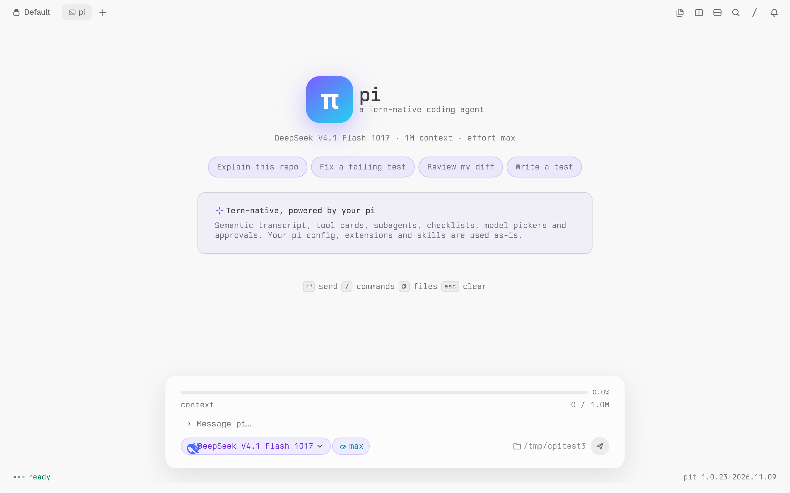
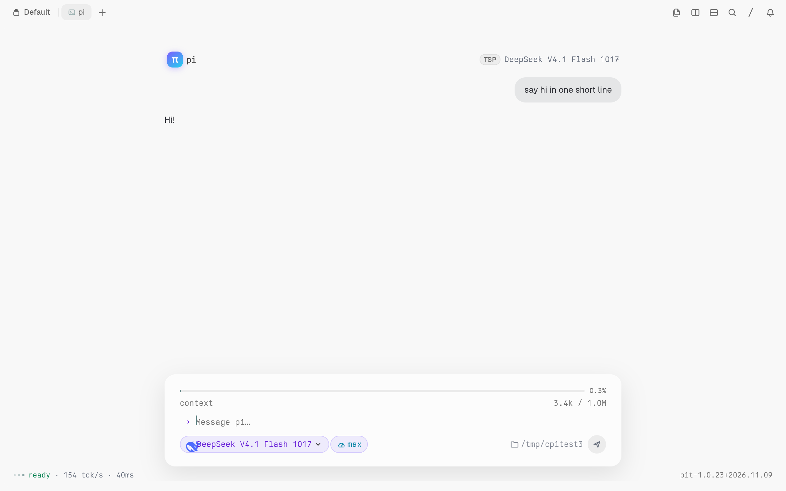
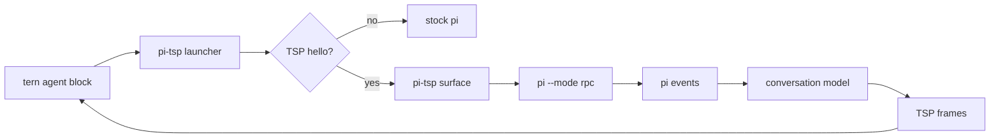

<p align="center">
  
</p>

<h1 align="center">pi-tsp</h1>

<h3 align="center">The pi coding agent, rendered native in Tern.</h3>

<p align="center">
  A real surface for pi: semantic markdown, tool cards, diffs, subagents,
  approvals, model and effort pickers, session management, and a composer that
  belongs in Tern.<br>
  No ANSI mirror. No patched pi. Stock pi outside Tern.
</p>

<p align="center">
  
  
  
  
  <a href="https://github.com/MadeBy561/pi-tsp/actions/workflows/ci.yml"></a>
  <a href="https://github.com/MadeBy561/pi-tsp/releases"></a>
</p>

<p align="center">
  
</p>

---

## Why this exists

`pi` is a strong terminal coding agent. Tern can render native surfaces, but a
terminal agent that only paints ANSI gives Tern nothing to work with: every
message is a wall of text in a grid.

`pi-tsp` keeps pi as the engine and gives Tern the conversation as data. It
speaks the Tern Surface Protocol, runs `pi --mode rpc` as a child, and renders
the transcript itself. Markdown is markdown. A tool call is a card with its
arguments and result. A diff is a diff. A subagent is a row you can open. The
composer is a Tern composer, not a cursor in a terminal.

The boundary is deliberate: pi owns the agent loop, tools and sessions; pi-tsp
owns the surface. Nothing in pi is patched, and outside Tern `pi-tsp` execs
stock `pi` with the original arguments.

## What it does

<table>
  <tr>
    <td width="50%"></td>
    <td width="50%"></td>
  </tr>
  <tr>
    <td align="center"><sub><b>Transcript</b> — user and assistant turns, tool cards, timing and token rate, with the model and effort chips in the composer.</sub></td>
    <td align="center"><sub><b>Launch</b> — branded empty state, starter prompts, centered composer, context meter and the live working directory.</sub></td>
  </tr>
</table>

| Surface | What you get |
|---|---|
| Transcript | Semantic markdown, headings, lists, tables, code, links, math |
| Tools | Read, write, edit, bash, grep, find, tests and web tools as cards; diffs with hunks and stats |
| Read grouping | Consecutive reads collapse into one expandable card |
| Executions | Bash and Python/eval rows with output and exit status |
| Thinking | A collapsible reasoning row when the model emits it |
| Notifications | Completion toast through Tern program notifications (`pi` / `Complete`) |
| Shell | `!command` runs through pi and adds output to context; `!!command` keeps it out |
| Extension UI | Native `input` and `editor` dialogs, plus select/confirm approvals and status notices |
| Subagents | Agent, model, tools, tokens, elapsed time and a full transcript modal |
| Custom messages | Extension and hook messages, plus compaction and branch summaries |
| Todos | A native checklist board, progress and a composer chip |
| Approvals | Permission sheets with allow/deny, forwarded to the real pi permission flow |
| Plan mode | A native checklist and an Implement action |
| Pickers | Model and thinking-effort pickers that call pi's RPC state, not a fake label |
| Composer | Centered card, context meter, provider-logo model chip, effort chip, working directory, `Ctrl+V` clipboard image paste with preview, attachments, queued-message chips, `!` shell mode, `Alt+Enter` follow-up and send button |
| Commands | `/clear`, `/resume`, `/model`, `/effort`, `/plan`, `/implement`, `/agents`, `/todos`, `/search`, `/rename`, `/name`, `/new`, `/clone`, `/session`, `/thinking`, `/tree`, `/fork`, `/copy`, `/attach`, `/export`, `/import`, `/hotkeys`, `/settings`, `/scoped-models`, `/reload`, `/changelog`, `/compact`, `/help`, `/quit` |
| Sessions | Resume with preview, pin, rename, delete with confirmation, clone, import/export and tree/fork navigation |
| Settings | Native picker for auto-compaction, auto-retry, steering, follow-up and model/thinking; project `/trust` persistence |
| Copy | Copy a message/answer, a code block, or choose from a preview picker |
| Images | `/attach <path>` queues a png/jpg/gif/webp for the next prompt |
| Fallback | Outside Tern, `-p`, `--version` or a non-text mode runs stock `pi` |

## How it works



The launcher probes the TSP handshake on the pty before pi starts. If Tern
answers, it opens a screen surface, spawns `pi --mode rpc`, and diffs the
conversation model into TSP nodes. If Tern does not answer, it does the least
surprising thing: runs pi exactly as the user asked.

## Install

Requirements:

- Node.js **22.19+**
- `pi` **1.4+** on `PATH`, already configured with at least one model
- Tern **0.9.5+** for the native surface
- Optional: `pi-subagents` for subagent rows (`pi install npm:pi-subagents`)

Install from GitHub:

```sh
npm install -g github:MadeBy561/pi-tsp
pi-tsp
```

Or install a release tarball:

```sh
gh release download v1.0.23 --repo MadeBy561/pi-tsp --pattern '*.tgz'
npm install -g ./pi-tsp-1.0.23.tgz
pi-tsp
```

From source:

```sh
git clone https://github.com/MadeBy561/pi-tsp.git
cd pi-tsp
npm install -g .
pi-tsp
```

For development, use `npm link` instead of a global install:

```sh
npm link
pi-tsp
```

Run `pi-tsp` inside a Tern **agent block**. In a plain shell, or outside Tern,
it runs stock `pi`.

`pi-tsp --version` prints pi's own version.

## Configuration

pi-tsp keeps its state separate from your normal pi install:

```text
~/.pi-tsp/
  agent/        copied pi model configuration, extensions and themes
  sessions/     pi-tsp sessions
```

On first run it copies `~/.pi/agent/models.json` into `~/.pi-tsp/agent/` and
symlinks installed pi packages, so models, skills, subagents and extensions
keep working without a second setup. The user's `~/.pi` is read-only to
pi-tsp. The config directory is created `0700` and copied files `0600`, because
the pi model configuration can contain provider keys.

No credentials, tokens or model keys live in this repository. They stay in the
local pi configuration, exactly where pi already keeps them.

## Release policy

pi-tsp uses Semantic Versioning and one release per merged improvement:

1. Every PR bumps `package.json` and adds a matching `CHANGELOG.md` section.
2. The `version-check` workflow rejects a PR whose version is not higher than
   `main`.
3. Merging to `main` runs `release.yml`, which creates `v<version>`, publishes
   a GitHub release and attaches `pi-tsp-<version>.tgz`.

See [CONTRIBUTING.md](CONTRIBUTING.md) for the full workflow and
[CHANGELOG.md](CHANGELOG.md) for release notes.

## Tests

```sh
npm test
```

The suite covers the model-label mapping, message roles, todo state, image
rendering and the stock-pi fallback. The fallback test skips cleanly when `pi`
is not installed, so the repository can be built on a machine without pi.

For a manual surface check inside Tern:

```sh
node bin/pi-tsp
```

Then type a prompt, run a tool-calling task, open `/model` and `/effort`, try
`/resume`, `/copy`, `/todos`, `/compact`, and session deletion.

## Limits

This is a real surface, not a claim of perfect parity with every terminal
feature:

- Compaction and branch summaries render when pi emits them; a controlled
  large-session benchmark is still on the roadmap.
- Subagent rows depend on the optional `pi-subagents` pi package.
- Pi's native tree-navigation flow is not exposed as a pi-tsp command yet.
- Narrow layouts and very long transcripts are implemented but not
  continuously benchmarked.
- Model aliases fall back to the configured model name when pi has no friendly
  label.

## Repository

```text
bin/pi-tsp              launcher entry point
src/launcher.mjs        TSP handshake probe and stock-pi fallback
src/ui.mjs              surface lifecycle, composer, pickers, RPC events
src/rpc.mjs             pi --mode rpc child and JSONL protocol
src/state.mjs           pi events -> conversation items
src/view.mjs            items -> TSP nodes and theme
src/tsp.mjs             frames, credits, blobs
src/keys.mjs            composer and key handling
src/sessions.mjs        session discovery and previews
ext/                    pi extensions used by the surface
test/                   unit and smoke tests
docs/                   screenshots and logo
.github/workflows/      CI, version check and release
```

## Credits

- [pi](https://github.com/earendil-works/pi) by Earendil Works — the agent and
  RPC protocol.
- [Tern](https://stencil.so/tern) by Stencil Labs — the terminal and the Tern
  Surface Protocol.
- [oh-my-pi](https://github.com/can1357/oh-my-pi) — the reference TSP client
  whose surface ideas informed this work.

Not affiliated with Stencil Labs or Earendil Works.

## License

MIT. See [LICENSE](LICENSE).
